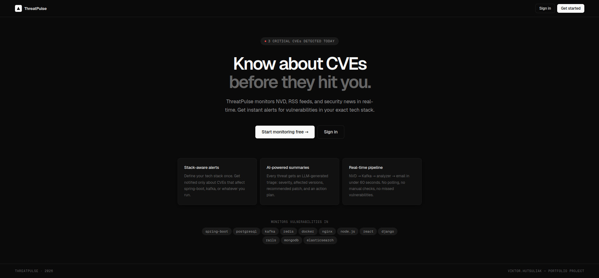
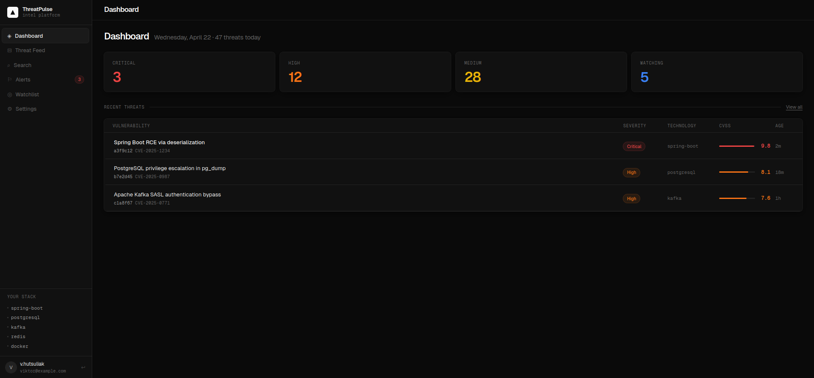
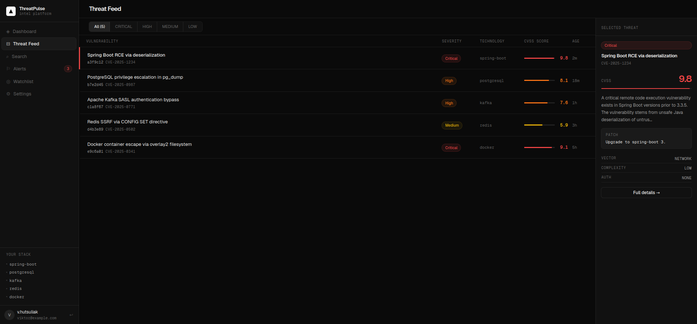
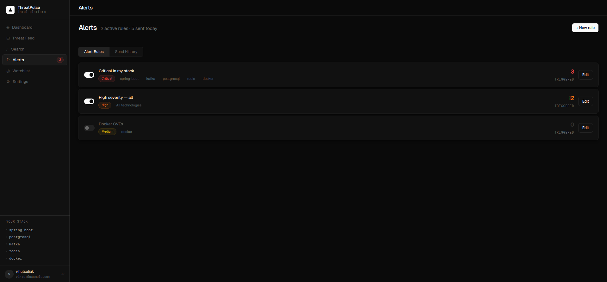
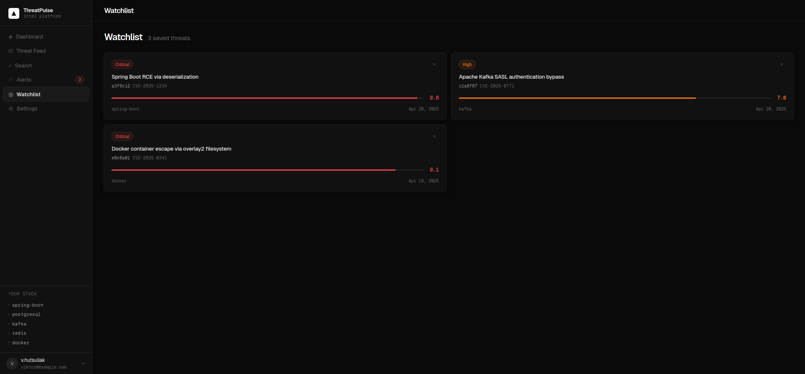
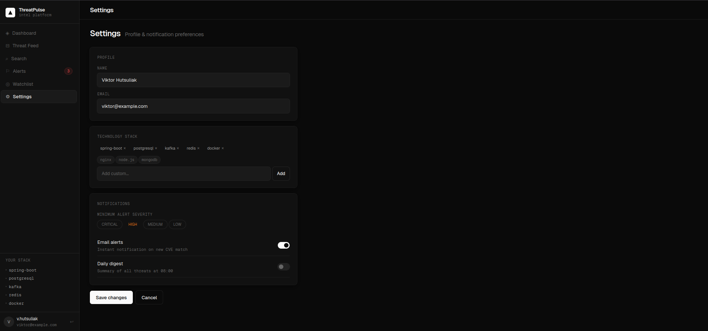

# ThreatPulse

**A security intelligence tool for developers.** It collects CVEs and security news from public sources, lets an LLM classify them, and alerts you only about what matches the technologies you run.

ThreatPulse collects **no personal data**: an account is a nickname and a password, there is no email address, and the intended way to run it is on your own machine.

---

## Motivation

CVE feeds and security newsletters dump hundreds of items a day. Most of them do not apply to what you run, and the ones that do are buried. ThreatPulse reads NVD and security RSS feeds, asks an LLM what is actually affected and how severe it is, and shows you the items that match your stack.

## Two ways to run it

| | Local installation | Hosted demo |
|---|---|---|
| Purpose | The real tool, for one person | Look at the interface without installing anything |
| Accounts | One account, created on first start from your environment variables | One shared demo account, no registration |
| Account changes | Nickname and password can be changed in Settings | Disabled (the account is shared) |
| Email | Optional, off by default | Off |
| Personal data stored | None | None |

The switch is configuration, not code: see [Account features](#account-features).

---

## Quick start (local installation)

**Prerequisites:** Docker.

```bash
git clone https://github.com/Vtoshik/threatpulse
cd threatpulse

# 1. Configuration: copy the example and choose your nickname and password
cp .env.example .env
#    edit .env: TP_USERNAME, TP_PASSWORD (not "change-me"), JWT_SECRET, and the API keys you have

# 2. Database, backend and frontend in one command (the first build takes a few minutes)
docker compose -f docker-compose.local.yml up --build
```

Open http://localhost:9000 and sign in with `TP_USERNAME` / `TP_PASSWORD`.

Only the web ports are published, and only on `127.0.0.1`. The database is reachable by the backend alone. Your data stays in the `threatpulse_local_data` Docker volume; `docker compose -f docker-compose.local.yml down -v` deletes it.

<details>
<summary>Run from source instead (Java 21, Node.js 22)</summary>

```bash
docker compose up -d postgres

cd backend
set -a && source ../.env && set +a
./mvnw spring-boot:run -Dspring-boot.run.profiles=local

# second terminal
cd frontend && npm install && npm run dev
```

</details>

The application refuses to start when `TP_PASSWORD` is empty, shorter than 8 characters, or the placeholder. A default password on a security tool would be a vulnerability, so there is none.

Without `GROQ_API_KEY` collected items are stored but stay hidden until they can be analyzed (the log says so once at start). Without `HUGGINGFACE_API_KEY` search falls back to keyword search.

---

## How it works

```
[Data sources]
NVD/NIST API ─┐
Security RSS ─┴──► Collector ──► Analyzer (LLM + embeddings) ──► PostgreSQL + pgvector
                                      │
                                      ├──► Alerts ──► in-app alert + live notification
                                      └──► Feed / semantic search ──► REST API ──► Vue dashboard
```

- **Collector** reads NVD and three security RSS feeds on a schedule.
- **Analyzer** asks the LLM for severity, category, a summary and the affected technologies, and creates an embedding. A failed analysis is saved as *pending* and retried by a background job. Nothing is made up and pending items never reach the feed or an alert.
- **Alerts** match a threat against each user's rules (minimum severity and technologies). Technology names are brought to one spelling (`Node.js` and `node` both become `nodejs`) before they are compared.
- **Search** is a vector similarity search (pgvector). It falls back to keyword search when the embedding service is unavailable or no stored item has an embedding yet.

Kafka connects the stages when `app.pipeline.kafka-enabled` is true (the default, used by the `dev` profile). The `local` and `prod` profiles run the same logic in one process without Kafka.

### Notifications

An alert always appears in the **Alerts** page. With Kafka enabled it is also pushed to a connected browser as a live notification.

Email is an optional extra channel for people who host it themselves. It is off by default, the recipient is set in the server configuration (`EMAIL_ALERTS_TO`, never stored in the database), and each user opts in with the *Email alerts* switch in Settings. An alert is recorded as delivered only when the provider accepted it. In the no-Kafka modes a temporary failure is retried by the alert scheduler (every 10 minutes, for threats analyzed in the last 24 hours); with Kafka a failed delivery is not retried.

---

## Account features

Controlled by three properties (environment variables in the `prod` profile):

| Property | Environment variable (`prod`) | Effect |
|---|---|---|
| `app.auth.registration-enabled` | `REGISTRATION_ENABLED` | `POST /api/auth/register` creates accounts |
| `app.auth.demo-enabled` | `DEMO_ENABLED` | `POST /api/auth/demo` returns a token for the shared demo account |
| `app.auth.credentials-change-enabled` | `CREDENTIALS_CHANGE_ENABLED` | `PUT /api/user/credentials` may change nickname and password |

`GET /api/auth/config` reports the three switches (and whether email alerts are available) so the interface hides what the server would reject.

---

## Tech stack

| Layer | Technologies |
|-------|-------------|
| Backend | Java 21, Spring Boot 3.5, Spring Security (JWT, Argon2), Spring Data JPA, Flyway |
| AI | Groq API (`openai/gpt-oss-120b`), Hugging Face Inference API (`BAAI/bge-small-en-v1.5`, 384 dimensions) |
| Data | PostgreSQL 16 + pgvector; optional Apache Kafka and Redis |
| Frontend | Vue 3, TypeScript, Quasar, Pinia, WebSocket/STOMP |
| Delivery | Docker Compose (infrastructure), GitHub Actions, hosted demo on Vercel and Render |

---

## API

### Auth (public)
```
GET  /api/auth/config        which account features this server has
POST /api/auth/login         { username, password } -> { accessToken }
POST /api/auth/register      { username, password } (when enabled)
POST /api/auth/demo          shared demo account (when enabled)
```

### Threats (JWT required)
```
GET /api/threats             paginated feed (severity, category, technology filters)
GET /api/threats/{id}        single threat
GET /api/threats/stats       counts by severity and published in the last 24 hours
GET /api/threats/search      ?q=&limit=&severity=  semantic search with keyword fallback
```

### Alerts (JWT required)
```
GET    /api/alerts/rules
POST   /api/alerts/rules
PUT    /api/alerts/rules/{id}
DELETE /api/alerts/rules/{id}
GET    /api/alerts/history
```

### User (JWT required)
```
GET /api/user/profile
PUT /api/user/technologies
PUT /api/user/preferences
PUT /api/user/credentials    { currentPassword, newUsername?, newPassword? } (when enabled)
                             a new password invalidates earlier tokens and returns a fresh one
```

Bookmarks live under `/api/bookmarks`.

WebSocket: `/ws`. The STOMP `CONNECT` frame must carry `Authorization: Bearer <token>`. `/topic/threats` is open to every signed-in user, `/topic/alerts/{userId}` only to that user.

---

## Interface

| Landing | Dashboard |
|---|---|
|  |  |

| Threat feed | Alerts |
|---|---|
|  |  |

| Watchlist | Settings |
|---|---|
|  |  |

*The screenshots were taken before the nickname-only sign-in and may differ in small details.*

---

## Configuration

| Variable | Description |
|----------|-------------|
| `DATABASE_URL`, `DATABASE_USERNAME`, `DATABASE_PASSWORD` | PostgreSQL connection (JDBC URL, for example `jdbc:postgresql://localhost:5432/threatpulse`) |
| `JWT_SECRET` | Base64 secret, at least 32 bytes (`openssl rand -base64 32`) |
| `TP_USERNAME`, `TP_PASSWORD` | The account created on first start (`local` profile) |
| `GROQ_API_KEY` | LLM analysis (free at console.groq.com) |
| `HUGGINGFACE_API_KEY` | Embeddings for semantic search (token with "Make calls to Inference Providers") |
| `NVD_API_KEY` | Optional, raises the NVD rate limit |
| `EMAIL_ALERTS_ENABLED`, `EMAIL_ALERTS_TO`, `RESEND_API_KEY`, `RESEND_SOURCE_EMAIL` | Optional email channel (needs a verified sender domain at Resend) |
| `CORS_ALLOWED_ORIGINS` | Allowed frontend origins, default `http://localhost:9000` |
| `REGISTRATION_ENABLED`, `DEMO_ENABLED`, `CREDENTIALS_CHANGE_ENABLED` | Account features in the `prod` profile |

Outgoing HTTP calls have a 5 s connect and a 30 s read timeout (`spring.http.client.*`).

---

## Development

```bash
docker compose up -d                       # PostgreSQL, Kafka, Redis, Kafka UI
cd backend && ./mvnw spring-boot:run -Dspring-boot.run.profiles=dev
cd frontend && npm install && npm run dev
```

| Service | URL |
|---------|-----|
| Backend API | http://localhost:8080 |
| Frontend | http://localhost:9000 |
| Kafka UI | http://localhost:8090 |

The `dev` profile reads `backend/src/main/resources/application-dev.yml`. Copy `application-dev.yml.example` and fill in your keys; the file is git-ignored.

### Tests

```bash
cd backend && ./mvnw test        # needs Docker: integration tests start PostgreSQL with Testcontainers
cd frontend && npm run lint && npm run build
```

Unit tests alone: `./mvnw test -Dtest='!*IntegrationTest'`.

---

## Known limits

Stated plainly, so nobody has to find them:

- **The hosted demo account is shared and its data is writable.** Nobody can register or change the credentials, but every visitor can edit the shared watchlist, rules and bookmarks.
- **No token refresh and no logout endpoint.** A token lives until it expires (`JWT_EXPIRY_HOURS`). A password change does invalidate earlier tokens.
- **Semantic search has no relevance cut-off** and no vector index. It always returns the nearest items, even when none is close.
- **The LLM is a free-tier model.** The free daily token limit caps how many items can be analyzed per day; the rest wait as pending.
- **Caching is off in production** (`spring.cache.type: none`) until a managed Redis is chosen.
- **Email recipients are shared by all users** of one server, which is fine for the single-user local installation and not designed for a multi-user host.
- **Live updates are a push, not a history.** A browser that was closed misses what happened meanwhile; the feed shows it after a reload.

## Roadmap

- A command line scanner that reads `package-lock.json`, `pom.xml` or `requirements.txt` on your machine and sends only package names and versions, matched against OSV for exact version ranges.
- CISA KEV and EPSS enrichment to rank findings by real exploitation instead of LLM opinion alone.
- Token refresh and logout, more collectors (NewsAPI), Checkstyle and coverage gates in CI.

---

## Contributing

This is mostly a personal portfolio project. If you found a bug or have a suggestion, open an issue first.

For pull requests: branch from `dev`, keep a change focused, and run `./mvnw test` and `npm run build` before submitting.
